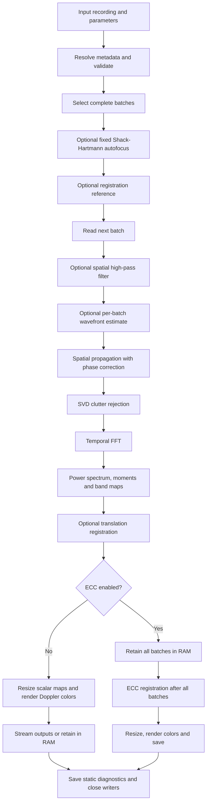

# How the main HoloDoppler pipeline works

This documents the `default` Laser Doppler Holography pipeline as implemented in
[`main_default.py`](../holodoppler/pipelines/main_default.py). It describes current
behavior, including surprising details; proposed improvements are listed separately.
The other registered pipelines (`lsci`, `pca_accumulation`,
`sliding_shack_hartmann`, `split_apertures`) are outside this walkthrough.

## Entry points and ownership

```bash
holodoppler preview path/to/recording.holo parameters/default_parameters_default.yaml
holodoppler process path/to/recording.holo parameters/default_parameters_default.yaml
```

To override the profile's backend for one run:

```bash
holodoppler process path/to/recording.holo parameters/default_parameters_default.yaml --backend numpy
```

The current profile uses these controls (excerpt, not a complete configuration):

```yaml
pipeline_name: default
backend: auto # auto, numpy, or cupy
save_averaged_spectrogram: true
directional_Doppler_image: true
```

There is no temporal-transform selector. The default pipeline always computes
the temporal FFT, and uses `moment0`, `moment0ff`, `moment1`, and `moment2`
throughout computation, registration, rendering, and saving.

The CLI loads YAML/JSON, applies overrides, and dispatches using `pipeline_name`.
The lazy registry maps `default` to `main_default.process` and `preview_default`
to `main_default.preview`. The registry forwards callbacks only when the called
function accepts them.

| Code | Responsibility |
| --- | --- |
| [CLI](../holodoppler/cli/command.py), [registry](../holodoppler/pipelines/__init__.py) | Configuration loading and pipeline dispatch |
| [Configuration](../holodoppler/config/) | Resolve metadata placeholders and validate parameters |
| [File readers](../holodoppler/file_reader/file_reader.py) | Read `.holo` or `.cine` frame batches |
| [Default pipeline](../holodoppler/pipelines/main_default.py) | References, optical processing, outputs, finalization |
| [Batch runner](../holodoppler/core/processing.py) | Ordered CPU/GPU execution and progress |
| [Filtering](../holodoppler/core/filtering.py), [propagation](../holodoppler/core/propagation.py), [moments](../holodoppler/core/moments.py) | Numerical operations |
| [Saving](../holodoppler/saving/README.md) | Output selection, bounded saving jobs, media and numerical exports |

## Overall flow



The temporal FFT always runs; it is part of the spectral pipeline, not a setting.

## 1. Setup and batch selection

The backend initially prefers CuPy if an actual CUDA operation succeeds;
otherwise it uses NumPy/SciPy. Each run selects `backend: auto`, `numpy`, or
`cupy`; the CLI can override it with `--backend`. Selecting `cupy` falls back
to NumPy if CUDA is unavailable.

The reader supplies file metadata. Values marked `use_holovibes` are resolved
from the `.holo` footer; supported `.cine` values marked `use_metadata` are
resolved from its header. Explicit numerical values remain unchanged. The
default pipeline passes its parameter mapping to resolvers that mutate it.
Validation happens after resolution.

[`calculate_batch_indices`](../holodoppler/core/batching.py) schedules only complete
batches. Let `N = batch_size`, `s = skip_every` (1 when omitted), and `b` be a
batch's starting source-frame index. The batch reads:

```text
b, b+s, b+2s, ..., b+(N-1)s
```

Starts advance by `batch_stride` source frames. `end_frame` is exclusive;
zero or a negative value means the end of the file. A batch fits when its last
selected frame is below that limit. Incomplete trailing batches are dropped.
If there are no complete batches, `process()` returns without producing outputs.

For example, `batch_size=256`, `skip_every=2`, `batch_stride=256` reads
`0,2,...,510`, then `256,258,...,766`: the batches overlap. Increasing
`skip_every` does not automatically increase the stride.

Batch arrays use `(N, H, W)`. The effective sampling frequency for frequency
calculations is `sampling_freq / s`, and FFT-bin spacing is that rate divided
by `N`. Batch cadence is instead `sampling_freq / batch_stride`.

## 2. Wavefront correction and registration references

### Fixed Shack-Hartmann autofocus

When enabled, `_get_autofocus_phase_term()` reads a reference starting at
`registration_ref_first_frame`, with `shack_hartmann_autofocus_batch_size`
selected frames (falling back to `batch_size`). This happens even if translation
registration is disabled. The reference receives the optional 2-D filter.

`_process_shack_hartmann()` constructs subaperture images using Fresnel or angular
spectrum propagation and estimates their displacements. It uses either the
graph-Laplacian or the alternative displacement method, then fits the selected
Zernike modes. The correction is `exp(-1j * phase)`.

Autofocus rejects missing/nonfinite coefficients, absence of mode 4, excessive
absolute Z4, or a missing/nonfinite phase. Rejection logs a warning and continues
without correction; it does **not** fall back to per-batch Shack-Hartmann.
Coefficients and diagnostics can still be saved after rejection.

An accepted correction is reused for every batch. For Fresnel propagation,
`_fixed_fresnel_kernel()` combines it with the input kernel once before scheduling.
Matching autofocus and explicit registration references reuse the raw frame read.

### Translation reference

When `image_registration` is enabled, full processing uses the configured
`registration_ref_first_frame` and `registration_ref_batch_size`. If these match
the first processing batch, its `moment0ff` becomes the reference. Otherwise a separate
reference batch is processed through filtering, wavefront correction, propagation,
SVD, and the zeroth moment; unrelated outputs are skipped.

When autofocus is disabled and `shack_hartmann` is enabled, a fresh phase correction
is estimated per processing batch, and for a separately processed reference.

## 3. Processing one batch

`_process_one_batch()` wraps `_process_batch()` and translation registration.

1. **Optional spatial filtering:** `filter_2d()` applies a spatial FFT, removes
   a central elliptical low-frequency region, and transforms back.
2. **Optional live wavefront estimate:** used only when fixed autofocus is
   disabled and `shack_hartmann` is enabled.
3. **Spatial propagation:** Fresnel or angular spectrum reconstructs complex
   holograms, applying the supplied phase correction when present.
4. **SVD clutter rejection:** holograms are cast to complex64. The implementation
   forms an `N × N` temporal covariance, eigendecomposes it, and projects away
   selected dominant modes. `number_of_values` removes the leading count;
   `amplitude_threshold` selects covariance eigenvalues above the threshold.
   `svd_remove_dc` subtracts the temporal mean first. A negative SVD threshold
   bypasses the entire filter, including mean removal. Pixel blocks limit
   intermediate work arrays, not total memory.
5. **Temporal FFT:** `fft(..., axis=0, norm="ortho")` always produces the complex
   spectrum. No temporal window is applied here.
6. **Power spectrum:** `P = abs(spectrum)**2`, optionally followed by corner
   compensation.
7. **Directional intermediates:** optional positive/negative maps are zeroth
   moments (sums of power) over directional PSD bins, with energy-preserving
   flat-field normalization. The existing inclusive directional bin intervals
   are preserved; they differ from the strict moment-band mask below.
8. **Moments and bands:** reduce selected frequency bins into spatial maps.
9. **Flat-field correction:** `moment0ff = moment0 / gaussian_filter(moment0, sigma)`,
   returning zero wherever the blurred denominator is zero (also for extra ranges).
10. **Translation registration:** estimate `(shift_y, shift_x)` against reference
    `moment0ff` and apply it to the selected scalar maps, Doppler intermediates, and
    retained PSD. Save the shift as `registration`.

The main frequency mask uses **strict** bounds:
`low_freq < abs(f) < high_freq`; omitting `high_freq` removes the upper bound.
Frequencies retain their signs in the moment calculation:

```text
moment0(y,x) = sum P(f,y,x)
moment1(y,x) = sum f * P(f,y,x)
moment2(y,x) = sum f² * P(f,y,x)
```

These are raw discrete sums: there is no division by `moment0` or multiplication by
frequency-bin width. `moment1` can cancel between positive and negative frequencies;
it is not a mean speed. Interpreting these as physical flow quantities requires
additional calibration and conventions outside this function.

## 4. Outputs and finalization

| Saved name | Meaning / shape before saving |
| --- | --- |
| `moment0`, `moment1`, `moment2` | Canonical names throughout processing; one `(H,W)` map per batch |
| `moment0ff` | Gaussian flat-field-normalized `moment0` |
| `spectrum_line` | Spatial mean of the full PSD; `(N,)` per batch |
| `band_k_low_high` | Mean PSD over the selected symmetric band; NaN if empty |
| `moment0_range_*`, `moment1_range_*`, `moment0ff_range_*` | Optional additional range moments and normalized power |
| `spectrograms` | Spatially resized, frequency-selected and frequency-binned PSD per batch |
| `averaged_spectrogram` | Full PSD averaged over the number of completed batches |
| `registration`, `registration_ecc` | Translation shifts and optional ECC transformations |
| `color_Doppler_image` | RGB composite from low/high symmetric power bands |
| `directional_Doppler_image` | HSV-derived RGB encoding of positive/negative spectrum maps |
| `shack_hartmann_*` | Optional wavefront, subaperture, coefficient and shift diagnostics |

With ECC disabled, `_finalize_spatial_result()` optionally resizes scalar maps
to `(max(H,W), max(H,W))`, then renders color/directional composites and removes
their internal intermediates. This stretches rectangular maps; it is not padding.
The default color mode decorrelation-stretches `[high, low, low]`; an alternative
uses Lab color with `moment0` lightness.

ECC runs after all batches on the CPU, using the first computed `moment0ff` as
reference. It can follow translation registration if both are enabled. It warps
selected maps and Doppler intermediates, then finalizes each batch individually.
The full averaged PSD does not receive ECC correction.

### Execution and memory

The shared `run_batches()` always delivers results in input order:

- **CPU:** 0 or 1 worker runs sequentially; larger counts use a bounded thread
  pool, capped at `max(1, cpu_count - 2)`. If needed, the first batch establishes
  a registration reference before parallel processing starts.
- **Synchronous GPU:** sequential batches, synchronized before consumption.
- **Asynchronous GPU:** one reader thread plus upload, compute, and download
  CUDA streams. Events enforce dependencies; compute remains ordered on a
  single stream. Pinned host buffers support transfers. `cupy_prefetch_depth`
  bounds all admitted batches, including pending reads. Consumption waits for
  the oldest result's download.

With `live_saving: true` and ECC disabled, results go straight to `OutputClass`.
With live saving disabled, temporal outputs are allocated after the first result
and retained for all batches. **ECC forces this buffering even with live saving
enabled.** On GPU, the full-PSD aggregate stays on device until finalization;
on CPU it is accumulated by the consumer. Both paths divide the accumulated PSD
by the number of completed batches once, before saving.

For `B` completed batches, the saved aggregate is:

```text
averaged_spectrogram(f,y,x) = (1/B) * sum_b PSD_b(f,y,x)
```

Each batch contributes equally, including overlapping batches. Translation
registration is applied to each retained PSD before accumulation when enabled;
ECC is not applied to this aggregate. Frequency binning for the per-batch
`spectrograms` output does not change the full frequency axis of this average.

Saving workers are separate from processing workers. Their bounded queue applies
backpressure, propagates errors, and drains before writers close. Media averages
use unquantized values before final PNG generation. Numerical HDF5 exports follow
an explicit name policy; rendered Doppler images and extra range moments are
excluded. Coefficients and registration data also receive CSV exports.

The normal destination is `<input parent>/<stem>/<stem>_HD/`, with preview in
its `preview` subdirectory. Overwrite policy can change destination handling.
Video playback defaults to 30 FPS unless `output_fps` is explicitly supplied;
it is not automatically the acquisition-derived batch cadence.

### Preview differs from full processing

Preview reads one batch at `first_frame`, optionally computes fixed autofocus,
processes and finalizes that batch, saves a preview bundle, and returns the NumPy
`moment0ff` image. Full `process()` saves outputs and returns `None`.

Preview uses its own `moment0ff` as the translation reference, ignoring a separately
configured registration reference. It does not run ECC or the normal spectrogram
preparation/aggregation path; retained PSD is saved as `sh_psd`. It also does not
use the full run's precombined Fresnel kernel optimization. A preview therefore
does not exercise every behavior of a full run.

## Review: remaining design concerns

The changes above resolve the original sum/average mismatch, backend selection,
zero-denominator flat-field division, configurable temporal FFT, amplitude-based
directional power, and internal moment-name translation. Remaining observations
come from code review, not scientific validation against experimental recordings.

1. **Directional bin boundaries differ from moment bands.** Directional maps now
   sum the same PSD as the moments, including optional corner compensation, but
   retain inclusive, one-based-derived bin intervals. These can include DC at low
   cutoffs, whereas moment masks use strict `fftfreq` bounds. Agree on the scientific
   binning convention before changing these boundaries.
2. **Moments are raw sums.** Signed `moment1` cancellation, unnormalized `moment2`,
   and the distinction between band means and moment sums need to remain explicit
   in the output contract and metadata.
3. **There are two orchestration implementations.** `core/pipeline.py` provides
   setup, accumulation, ECC and saving for other pipelines. The default pipeline
   still owns its own orchestration for GPU aggregation and delayed color rendering.
   Shared lifecycle operations could be extracted gradually while preserving these
   requirements.
4. **Output meaning is encoded in strings and dimensions.** Registration, resizing
   and saving independently infer semantics from keys and shapes. An output
   specification with axes, spatial/temporal role, registration policy and export
   formats would make additions safer. Generic saving shape inference can confuse
   a grayscale stack of width 3 or 4 with a color image.
5. **Preview and full processing offer different guarantees.** Preview does not
   verify explicit-reference alignment, ECC, or spectrogram binning. Shared setup
   and finalization with an explicit preview policy would reduce drift.
6. **Configuration is mutable and inconsistently defaulted.** Metadata resolution
   can change the caller's dictionary. Validation sometimes checks a default
   without inserting it, while processing later indexes the key directly. Build a
   complete resolved configuration once. Legacy spellings such as
   `Fresnel_use_ouput_kernel` and `save_spectograms` also remain.
7. **Memory and time behavior can surprise users.** ECC buffers all outputs even
   with live saving; video playback FPS is independent of acquisition cadence.
   Both should be visible before a run, with buffering estimates and distinct
   timing metadata.
8. **`_process_to_output()` has many responsibilities.** It owns reference setup,
   GPU aggregation, callbacks, ECC, and static/temporal saving. Explicit run state
   and finalization functions could clarify ownership and failure cleanup.
